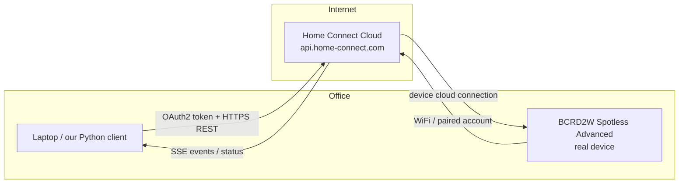
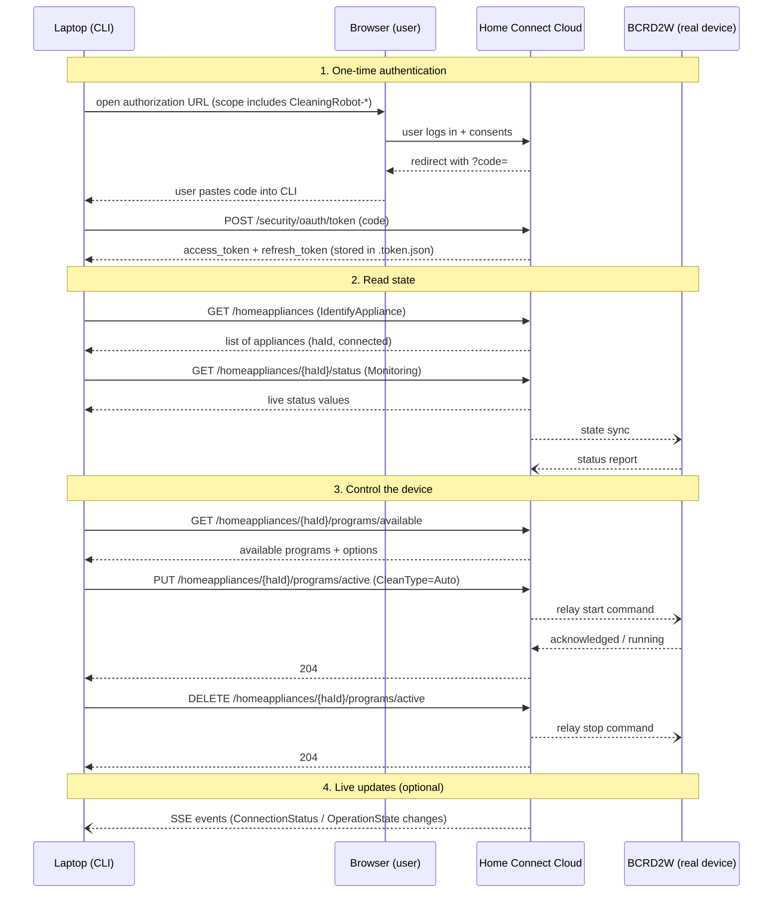
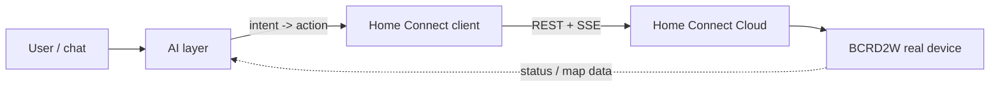

# Architecture — communicating with the real device from the laptop

> **Important:** We work against a **real Bosch Spotless BCRD2W in the office**, not a
> virtual/simulated appliance. Commands issued through the API are executed by the
> physical vacuum — treat every write as a real action.

## System overview

The laptop does **not** talk to the device directly over the local network. The BCRD2W
keeps its own live connection to the **Home Connect cloud**, and our laptop communicates
with that cloud through the Home Connect REST API. The cloud relays commands to the
device and streams back its state.

## Actors and roles

| Actor | Role |
| --- | --- |
| Laptop (us) | OAuth2 client + REST caller; runs `src/cli.py` |
| Home Connect Cloud | Authorizes us (OAuth2), proxies commands, holds maps/status |
| BCRD2W (real device) | Executes programs; connected to cloud via its own link |
| Browser (one-time) | User login + authorization consent for OAuth2 |

## Communication flow

## Key technical facts (from `hcsdk-production.yaml`)

- **Auth**: OAuth2 authorization-code flow.
  - Authorization URL: `https://api.home-connect.com/security/oauth/authorize`
  - Token URL: `https://api.home-connect.com/security/oauth/token`
- **API base**: `https://api.home-connect.com/api`, media type
  `application/vnd.bsh.sdk.v1+json`.
- **Scopes used**: `IdentifyAppliance`, `CleaningRobot`, `CleaningRobot-Control`,
  `CleaningRobot-Monitor`, `CleaningRobot-Settings`, `CleaningRobot-Map`.
- **Start/stop**: `PUT`/`DELETE /homeappliances/{haId}/programs/active`.
- **Status**: `GET /homeappliances/{haId}/status`.

## Getting access to the real API

- To experiment with the real API, you will have to create a new application.
  Host: `https://api.home-connect.com`.
- For your application to interact with home appliances it needs to get authorized by the
  API. To get started, visit the Home Connect Developer Portal
  (https://developer.home-connect.com) and register an account. To start testing on a
  real appliance, you should register an application first. When prompted, log in with
  your Home Connect Account and grant access.

## Real-device prerequisites (office)

1. The BCRD2W is powered on and **connected to the same Home Connect account** that the
   developer app uses (device was paired with the account that owns it).
2. **Remote Control** is enabled on the device, and *Remote Control Start Allowed* is on
   (`BSH.Common.Setting.RemoteControl*`). Without this, `PUT /programs/active` will fail.
3. The device has enough battery and is on the charging dock / ready state.
4. The laptop has internet access to `api.home-connect.com`.

## Safety rules for the real device

- Read-only endpoints (`status`, `programs`, `appliances`) are always safe.
- Before `start`, always confirm the program key/options via
  `GET .../programs/available` — never guess.
- Prefer testing against the Home Connect SIMULATOR first, then switch to the real
  device once payloads are verified.
- `stop` idempotent and safe; `start` changes the physical device state — double-check
  type (`Auto`, `CleanSpot`, ...) before sending.

## Where the AI layer connects in (future work)

The AI sits between the user and the raw API: it ingests status/events/maps, decides,
and calls the same control endpoints above. See `GOALS.md` and
`docs/communication-now-vs-ai.md` for before/after diagrams.

