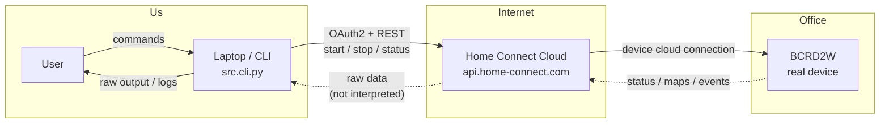
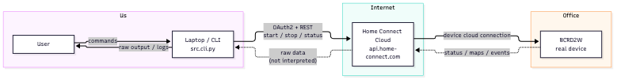
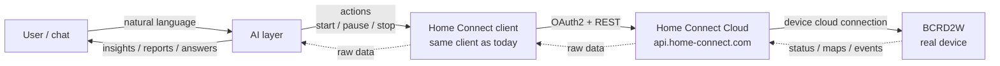
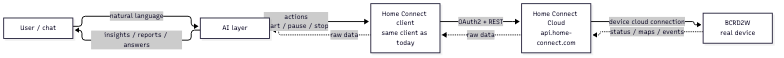

# Communication — now vs. with the AI layer

Compare how our system talks to the real Bosch Spotless BCRD2W today, and how it will
look once the AI layer is in the middle of the loop.

## Current state (no AI)

The laptop drives the device directly through the Home Connect cloud. There is no
intelligence between the user/CLI and the raw API — commands are explicit, and data
(status, maps) is only viewed, not interpreted.

Flow: `User → CLI → Home Connect cloud → device`. Data comes back raw — somebody has to
read and interpret it manually.

## Future state (with AI layer)

The AI layer sits **between the user and the raw API** and is always in the loop: it
ingests state/events/maps, interprets them, decides, and issues the same commands the CLI
uses today. The device wiring (cloud relay) does not change — only the brain on our side.

Flow: `User → AI layer → Home Connect client → cloud → device`, and the full loop back:
`device → cloud → client → AI layer → user`.

## What changes (and what does not)

| Aspect | Today | With AI layer |
| --- | --- | --- |
| User interaction | explicit CLI commands | natural language (chat/voice) |
| Control decision | human decides | AI decides (triggers, schedules, context) |
| Data interpretation | raw output / logs | AI interprets status, events, maps |
| Device / cloud wiring | Home Connect cloud relay | **unchanged** (same REST endpoints) |
| Code | `src.cli.py` drives API | AI layer calls the same client |
